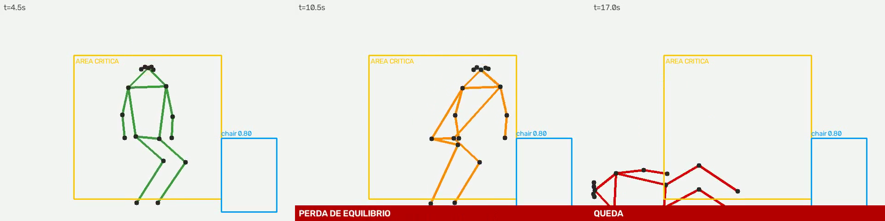
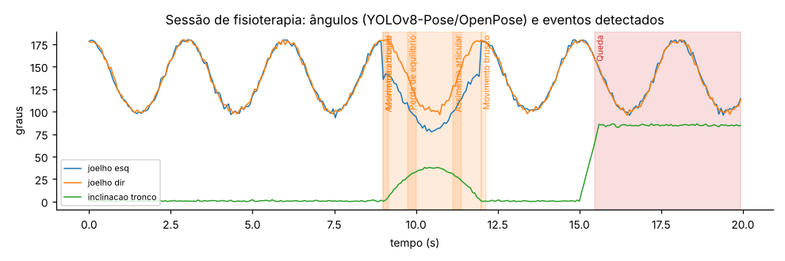
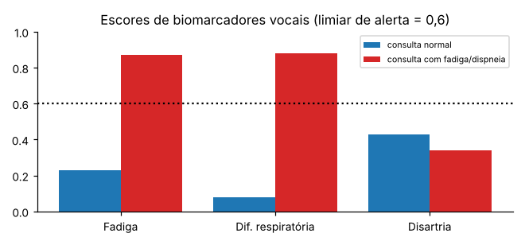

# Relatório Técnico — Monitoramento Multimodal de Pacientes
**Tech Challenge — Fase 4**

## 1. Objetivo

Monitorar pacientes combinando **vídeo** (sessões de fisioterapia ou cirurgias gravadas) e **áudio**
(consultas médicas) para identificar sinais precoces de risco e **alertar a equipe médica**.

A solução foi desenhada para ser **simples, explicável e executável em CPU**: cada módulo produz alertas com
justificativa legível, e todos convergem para uma central única com fusão multimodal, acessada por uma
interface gráfica em Streamlit.

---

## 2. Fluxo multimodal

```
 ┌───────────────┐  YOLOv8-Pose (keypoints COCO/OpenPose)  ┌────────────────────────────┐
 │ 🎥 Vídeo       │──YOLOv8 (objetos / área crítica)───────▶│ eventos + relatório        │──┐
 └───────────────┘                                         └────────────────────────────┘  │   ┌───────────────┐    ┌──────────────────┐
                                                                                           ├──▶│ 🚨 Central de  │──▶ │ 🧠 Fusão          │
 ┌───────────────┐  biomarcadores vocais (numpy/scipy)     ┌────────────────────────────┐  │   │    Alertas     │    │ (late fusion)    │
 │ 🎙️ Áudio       │────────────────────────────────────────▶│ fadiga / respiração /      │──┘   │ SQLite + dedup │◀── │ risco/paciente   │
 └───────────────┘                                         │ disartria                  │      │ + Teams/Slack  │    └──────────────────┘
                                                           └────────────────────────────┘      └───────┬───────┘
                                                                                                       ▼
                                                                                         👩‍⚕️ Equipe reconhece o alerta
```

1. **Entrada**: upload na interface (vídeo, áudio ou keypoints em JSON) ou dados de exemplo.
2. **Processamento por modalidade**: vídeo e áudio são analisados de forma independente.
3. **Alerta**: todo achado vira um objeto `Alert` (paciente, origem, severidade 🔵/🟠/🔴, título, mensagem).
   A central grava em SQLite (histórico), elimina duplicatas e, se configurado, envia alertas de
   atenção/críticos para um canal do Microsoft Teams ou Slack, além do aviso na tela.
4. **Fusão (late fusion)**: os alertas em aberto viram escores por modalidade, combinados em um
   **risco único por paciente**. Alterações simultâneas em vídeo e áudio geram o alerta
   *“Risco multimodal elevado”*.
5. **Resposta**: a equipe reconhece o alerta na Central, o que reduz o risco fundido (fecha o ciclo).

---

## 3. Modelos aplicados em cada tipo de dado

### 3.1 Vídeo — `src/video_analysis.py`

| Etapa | Modelo / técnica |
|---|---|
| Postura | **YOLOv8-Pose** (`yolov8n-pose.pt`): 17 keypoints no padrão COCO — mesma topologia corporal do **OpenPose** (o módulo também aceita keypoints do OpenPose via JSON). |
| Objetos / áreas críticas | **YOLOv8** (`yolov8n.pt`, COCO-80): instrumentos (tesoura, faca), objetos não estéreis (celular, copo, garrafa) e uma **área crítica** configurável (campo estéril ou zona do leito). |
| Métricas biomecânicas | ângulos de joelhos e cotovelos (lei dos cossenos), inclinação do tronco em relação à vertical, velocidade do quadril, razão de aspecto do corpo. |
| Regras de evento | **Queda** (tronco > 60° e corpo na horizontal após descida rápida do quadril) · **Perda de equilíbrio** (tronco acima do limite) · **Assimetria articular** (diferença entre joelhos acima do limite) · **Movimento brusco** (velocidade angular acima do limite) · **Amplitude reduzida** (meta de flexão não atingida) · **Paciente fora do campo** · **Objeto indevido na área crítica** · **Contagem de instrumentos divergente** (início × fim da cirurgia) · **Instrumento fora do campo**. |
| Saída | vídeo anotado (H.264), gráfico de ângulos com os eventos e **relatório automático** em Markdown. |

Todos os limites (inclinação, assimetria, meta de flexão, velocidade, área crítica) são ajustáveis na interface,
representando o “padrão esperado” de cada procedimento.

### 3.2 Áudio — `src/audio_analysis.py`

| Etapa | Técnica |
|---|---|
| Pré-processamento | conversão para WAV PCM 16 kHz mono (ffmpeg). |
| Segmentação | janelas de 30 ms (passo de 10 ms) e detecção de voz por limiar adaptativo de energia. |
| Biomarcadores vocais | proporção de pausas, pausas longas por minuto, taxa de articulação (núcleos silábicos), energia (RMS), **F0** por autocorrelação e sua variação em semitons (monotonia), **jitter**, **shimmer**, **HNR** e ruído respiratório nas pausas. |
| Escores (0–1) | **Fadiga** (pausas, monotonia, fala lenta) · **Dificuldade respiratória** (pausas longas frequentes, ruído respiratório) · **Disartria** (jitter, shimmer, HNR baixo). Cada escore é a média de rampas lineares entre faixas de referência da fala adulta e vem com justificativa textual. |
| Alertas | escore ≥ 0,6 → atenção; ≥ 0,8 → crítico. |

### 3.3 Fusão multimodal — `src/fusion.py`

Escore da modalidade *m* = severidade do alerta mais grave (🔵 0,1 · 🟠 0,45 · 🔴 1,0) + 0,05 por recorrência.
Risco fundido por **OU ruidoso ponderado**:

  **risco = 1 − Π (1 − wₘ · sₘ)**, com pesos: vídeo 0,8 · áudio 0,7.

Uma evidência forte em uma só fonte já eleva o risco, e evidências em fontes diferentes se somam.

---

## 4. Dados utilizados

Dados **sintéticos com eventos inseridos em pontos conhecidos** (`src/sample_data.py`), para permitir conferir
os resultados de forma objetiva:

| Paciente | Vídeo (fisioterapia — agachamentos) | Áudio (consulta) |
|---|---|---|
| P-001 — Maria, 68 anos, fisioterapia após cirurgia no joelho | perda de equilíbrio aos 9 s e **queda aos 15 s** | — |
| P-002 — João, 62 anos, recuperação de pneumonia (cansaço e falta de ar) | perda de equilíbrio aos 9 s, sem queda | **fala com fadiga e dispneia** |
| P-003 — Ana, 35 anos, fisioterapia para dor nas costas | sessão dentro do padrão | fala normal |

As sequências de vídeo são keypoints COCO-17 (o mesmo formato produzido pelo YOLOv8-Pose), o que permite rodar
a análise sem GPU. Vídeos reais (mp4/avi/mov) passam pelo YOLOv8 na própria interface.

---

## 5. Resultados obtidos e exemplos de eventos detectados

Reproduzíveis com `python scripts/gerar_resultados.py` (números em `docs/resultados.json`) e validados pelos
testes automatizados (`pytest`: 9/9).

### 5.1 Resumo

| Modalidade | Eventos inseridos | Detectados | Alertas indevidos |
|---|---|---|---|
| Vídeo | 3 (2 desequilíbrios, 1 queda) | 3/3 (+ assimetria e movimento brusco associados ao desequilíbrio) | 0 na sessão normal |
| Áudio | 1 consulta alterada × 1 normal | separadas corretamente | 0 na consulta normal |

### 5.2 Vídeo — sessão de fisioterapia com queda (P-001)




| Tempo | Evento | Severidade | Detalhe |
|---|---|---|---|
| 9,0–10,0 s | Assimetria articular | 🟠 | diferença entre joelhos de até 43° |
| 9,0 s | Movimento brusco | 🟠 | 622°/s no joelho esquerdo |
| 9,7–11,4 s | Perda de equilíbrio | 🟠 | inclinação do tronco até 38° (limite 25°) |
| 15,5–19,9 s | **Queda** | 🔴 | corpo na horizontal após descida do quadril a ~450 px/s |

Relatório gerado automaticamente: [`relatorio_video_exemplo.md`](relatorio_video_exemplo.md).
A sessão do P-002 apresenta apenas os eventos de desequilíbrio (🟠), e a do P-003 nenhum evento.
No modo **Cirurgia**, os testes validam o alerta crítico de **contagem de instrumentos divergente**.

### 5.3 Áudio — consultas



| Indicador | Consulta normal (P-003) | Consulta com fadiga/dispneia (P-002) |
|---|---|---|
| Proporção de pausas | 23% | 58% |
| Pausas longas por minuto | 0 | 25 |
| Variação de F0 (semitons) | 2,2 | 0,6 (voz monótona) |
| Ruído respiratório nas pausas | −34 dB | −17 dB |
| Escore fadiga / respiratório / disartria | 0,23 / 0,08 / 0,43 | **0,87 / 0,88** / 0,34 |
| Alertas | nenhum | 🔴 Fadiga vocal · 🔴 Dificuldade respiratória na fala |

### 5.4 Fusão e alertas à equipe

| Paciente | Vídeo | Áudio | **Risco** | Nível |
|---|---|---|---|---|
| P-001 | 1,00 | 0,00 | **80%** | 🔴 Crítico |
| P-002 | 0,65 | 1,00 | **86%** | 🔴 Crítico |
| P-003 | 0,00 | 0,00 | **0%** | 🟢 Baixo |

O P-002 ilustra a fusão: o vídeo isolado indicaria apenas atenção (desequilíbrio), mas, somado à voz com sinais
de fadiga e dispneia, gera o alerta **“Risco multimodal elevado (86%)”** com as duas fontes citadas.

A demonstração completa gera 14 alertas (4 críticos e 10 de atenção), todos rastreáveis na Central de Alertas,
com reconhecimento pela equipe e exportação em CSV.

---

## 6. Limitações e próximos passos

- Dados sintéticos: os resultados demonstram o funcionamento do pipeline; validação clínica exigiria
  vídeos e gravações reais anotados (com consentimento) e datasets públicos como o AudioSet.
- Os biomarcadores vocais são heurísticos e dependem da qualidade da gravação; próximo passo: um classificador
  treinado com dados rotulados.
- Os limites das regras de vídeo são configuráveis, mas foram escolhidos de forma didática.

> Projeto acadêmico — não é um dispositivo médico.
